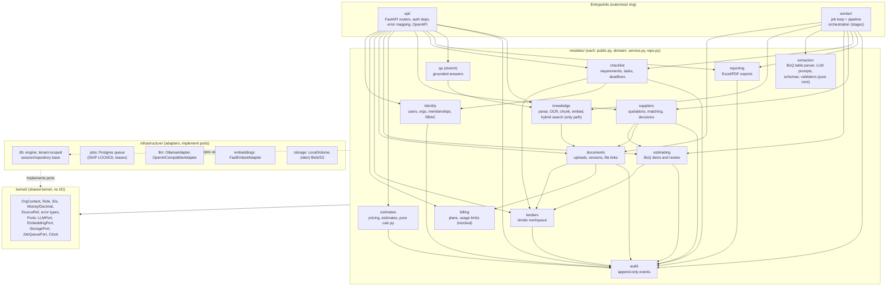

# C4 Level 3: Backend Components and Allowed Dependencies

An arrow `A --> B` means "A may import B's public facade (`modules/b/public.py`)". Anything not drawn is forbidden and is checked in CI by import-linter (ADR-0001). The graph is acyclic.

## Rules this diagram encodes

1. **Dependency Rule (Clean Architecture).** Entrypoints depend on modules; modules depend on `kernel`; adapters implement `kernel` ports. Modules never import `api/`, `worker/` or a concrete adapter (LLM, embeddings, storage, queue). Adapters are wired at startup in `api/main.py` and `worker/main.py`.
2. **Facade-only cross-module access.** A module imports only `other_module.public`. It never imports another module's ORM models or repositories and never queries another module's tables.
3. **Pure cores.** `extraction/` (whole module) and every `modules/*/domain/` package import neither `fastapi` nor `sqlalchemy`. They take DTOs in and return DTOs out, so they are unit-testable without a DB or a model.
4. **Worker orchestrates, extraction computes.** `extraction` never writes BoQ items or requirements. The worker passes chunks/tables in, gets validated candidates out, and hands them to `estimating.public` / `checklist.public` / `suppliers.public`, which persist them.
5. **Pragmatic exception.** Module repositories use SQLAlchemy directly through the tenant-scoped base in `infrastructure/db` (Repository pattern, PoEAA). We do not abstract the ORM. Tradeoff: a DB swap would touch every repo, which we accept.
