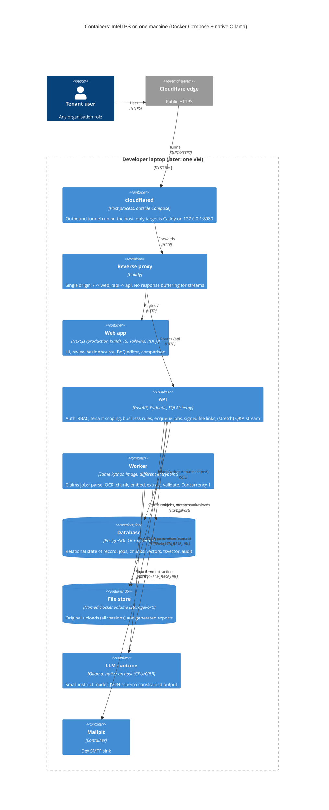

# C4 Level 2: Containers (IntelTPS)

Rules
- `cloudflared` is not part of the Compose stack: it runs on the host and connects to Caddy, which is published on `127.0.0.1:8080` only. Caddy is the only thing the tunnel can reach.
- Only Caddy is reachable from the tunnel. Postgres, Ollama, worker and Mailpit publish no ports to the public interface.
- API and worker are one codebase, one image, two entrypoints (`api`, `worker`). They share modules, not a network API.
- Embeddings (bge-small, CPU, ONNX) run in-process in the worker (indexing) and the API (query embedding for Q&A).
- `LLM_BASE_URL` points at `host.docker.internal:11434` locally; on a VM it points at a sidecar or same-host Ollama. Nothing else changes.
