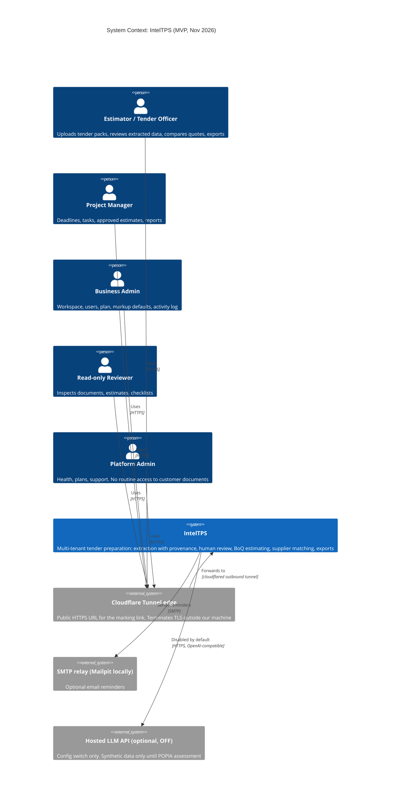

# C4 Level 1: System Context (IntelTPS)

Notes
- The local LLM (Ollama) is *inside* the system boundary: it runs on our machine. This is the core privacy decision (PRD §1, ADR-0003).
- Cloudflare is a third-party processor that sees decrypted traffic at its edge. Synthetic data only while the tunnel is used (see architecture.md, "PRD issues").
